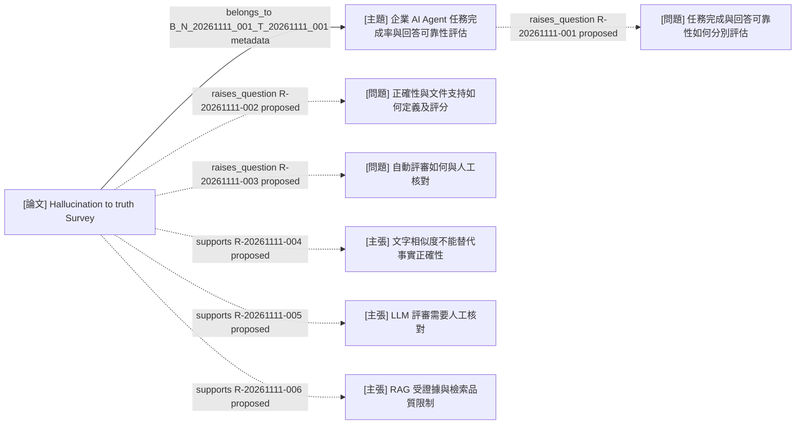

# T-20261111-001 知識圖譜

<!-- LS:GENERATED:BEGIN -->
## 生成範圍與圖例

- 研究目標：[企業 AI Agent 之任務完成率與回答可靠性評估](../topics/T-20261111-001.md)。
- 範圍：直接歸屬主題的一篇文獻、三個問題、三項主張；共八節點、七條邊，無子主題。
- 原生渲染狀態：**未經渲染驗證**；本檔 Mermaid 為正式圖譜來源。
- 實線為筆記 metadata 歸屬；虛線為 proposed／needs_review。本圖六條語意關聯均為 proposed。
- 任務完成率僅以研究問題呈現，尚無專門文獻；Survey 的引用研究未直接核讀，不建立假定已讀的文獻節點。

## 圖譜

## 節點來源

| 節點 ID | 類型 | 檔案／實體連結 |
| --- | --- | --- |
| T-20261111-001 | 主題 | [唯一研究目標與彙總](../topics/T-20261111-001.md) |
| N-20261111-001 | 論文 | [原始筆記；excerpt、draft](../notes/papers/N-20261111-001.md) |
| Q-20261111-001 | 問題 | [任務完成與回答可靠性](../references/entities.md#q-20261111-001) |
| Q-20261111-002 | 問題 | [定義與評分單位](../references/entities.md#q-20261111-002) |
| Q-20261111-003 | 問題 | [自動評審與人工核對](../references/entities.md#q-20261111-003) |
| C-20261111-001 | 主張 | [文字相似度限制](../references/entities.md#c-20261111-001) |
| C-20261111-002 | 主張 | [評審需人工核對](../references/entities.md#c-20261111-002) |
| C-20261111-003 | 主張 | [RAG 證據限制](../references/entities.md#c-20261111-003) |

## 關聯與證據

語意關聯的正式紀錄見[台帳](../references/relations.md)。

| R ID／衍生 B 識別 | from | relation | to | 狀態 | 證據 | 條件／警示 |
| --- | --- | --- | --- | --- | --- | --- |
| B_N_20261111_001_T_20261111_001 | N-20261111-001 | belongs_to | T-20261111-001 | metadata | [筆記 topic_ids](../notes/papers/N-20261111-001.md) | 由歸屬衍生，不是語意確認 |
| R-20261111-001 | T-20261111-001 | raises_question | Q-20261111-001 | proposed | [使用者研究背景](../notes/papers/N-20261111-001.md#研究背景與教授會議共識) | Agent 問題整理；任務完成率文獻待補 |
| R-20261111-002 | N-20261111-001 | raises_question | Q-20261111-002 | proposed | [E003](../notes/papers/N-20261111-001.md#e003)、[E005](../notes/papers/N-20261111-001.md#e005)、[E008](../notes/papers/N-20261111-001.md#e008) | 尚未選定評分單位與分母 |
| R-20261111-003 | N-20261111-001 | raises_question | Q-20261111-003 | proposed | [E006](../notes/papers/N-20261111-001.md#e006)、[E007](../notes/papers/N-20261111-001.md#e007) | 尚無人工核對實驗 |
| R-20261111-004 | N-20261111-001 | supports | C-20261111-001 | proposed | [E004](../notes/papers/N-20261111-001.md#e004) | Survey 轉述；相似度仍可輔助文字比較 |
| R-20261111-005 | N-20261111-001 | supports | C-20261111-002 | proposed | [E006](../notes/papers/N-20261111-001.md#e006)、[E007](../notes/papers/N-20261111-001.md#e007) | Survey 轉述；人工判斷亦有差異 |
| R-20261111-006 | N-20261111-001 | supports | C-20261111-003 | proposed | [E011](../notes/papers/N-20261111-001.md#e011) | Survey 轉述；企業適用性待驗證 |

## 覆蓋與省略

- 已讀來源與當時 updated：主題及 N-20261111-001 為 2026-11-11T19:08:21+08:00；Q001–Q003、C001–C003、R001–R006 各筆同時刻。重新核對筆記 E004、E006、E007、E011 及問題對應證據；不以台帳取代原始筆記。
- 閱讀限制：原論文筆記為 excerpt；本次未擴大其閱讀範圍，未重新完整核讀 HTML、PDF、圖表或被引用原始論文。
- 未讀／失效來源：追讀候選仍未讀；目前未發現失效端點或證據連結。
- 子圖／省略 ID 與原因：無，八個節點全部涵蓋。
- 台帳尚待核准的變更：無未寫入的改列草案；六條已存候選關聯均待使用者確認語意，未升為 confirmed。
<!-- LS:GENERATED:END -->
