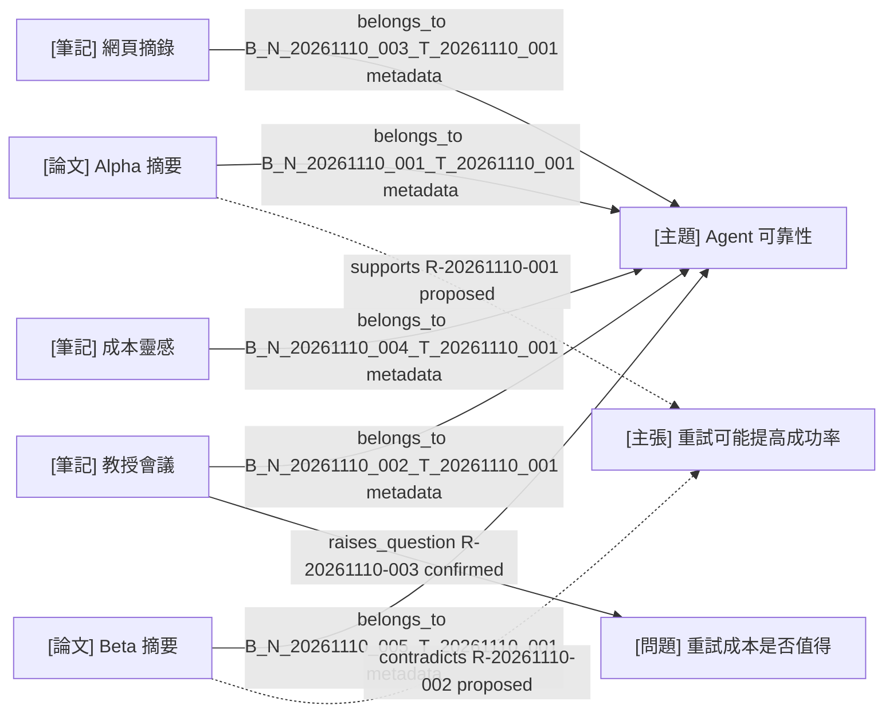

# 測試：可靠性知識圖譜

僅供隔離驗收，不是真實研究圖譜。

<!-- LS:GENERATED:BEGIN -->
## 生成範圍與圖例

- 範圍：T-20261110-001 直接歸屬五筆筆記，及與這些筆記相關的既有 C／Q 實體與三條語意關聯；不是任意節點的一階鄰接圖。
- 原生渲染狀態：未經渲染驗證。只檢查 Mermaid 文字、端點與逐邊來源。
- 節點前綴：主題、論文、筆記、問題、主張。
- 實線：metadata 歸屬或測試前提 confirmed；虛線：proposed。confirmed 不等於學術證實。

## 圖譜

## 節點來源

| 節點 ID | 類型 | 檔案／實體連結 |
| --- | --- | --- |
| T-20261110-001 | topic | [主題](../topics/T-20261110-001.md) |
| N-20261110-001 | paper | [Alpha](../notes/papers/N-20261110-001.md) |
| N-20261110-002 | meeting | [會議](../notes/meetings/N-20261110-002.md) |
| N-20261110-003 | web | [網頁摘錄](../notes/web/N-20261110-003.md) |
| N-20261110-004 | idea | [靈感](../notes/ideas/N-20261110-004.md) |
| N-20261110-005 | paper | [Beta](../notes/papers/N-20261110-005.md) |
| C-20261110-001 | claim | [主張](../references/entities.md#c-20261110-001) |
| Q-20261110-001 | question | [問題](../references/entities.md#q-20261110-001) |

## 關聯與證據

| R ID／衍生 B 識別 | from | relation | to | 狀態 | 證據 | 條件／警示 |
| --- | --- | --- | --- | --- | --- | --- |
| B_N_20261110_001_T_20261110_001 | N-20261110-001 | belongs_to | T-20261110-001 | metadata | [Alpha metadata](../notes/papers/N-20261110-001.md) | 另一主題歸屬不在本圖範圍 |
| B_N_20261110_002_T_20261110_001 | N-20261110-002 | belongs_to | T-20261110-001 | metadata | [會議 metadata](../notes/meetings/N-20261110-002.md) | 測試資料 |
| B_N_20261110_003_T_20261110_001 | N-20261110-003 | belongs_to | T-20261110-001 | metadata | [網頁 metadata](../notes/web/N-20261110-003.md) | 歸屬不等於來源可靠 |
| B_N_20261110_004_T_20261110_001 | N-20261110-004 | belongs_to | T-20261110-001 | metadata | [靈感 metadata](../notes/ideas/N-20261110-004.md) | 無外部證據仍可歸屬 |
| B_N_20261110_005_T_20261110_001 | N-20261110-005 | belongs_to | T-20261110-001 | metadata | [Beta metadata](../notes/papers/N-20261110-005.md) | 測試資料 |
| R-20261110-001 | N-20261110-001 | supports | C-20261110-001 | proposed | [Alpha E001](../notes/papers/N-20261110-001.md#e001) | 重讀更正後為 4/10 → 5/10，僅樣本 A，未一般化 |
| R-20261110-002 | N-20261110-005 | contradicts | C-20261110-001 | proposed | [Beta E001](../notes/papers/N-20261110-005.md#e001) | 樣本 B 皆 4/10，判定與資料條件不同 |
| R-20261110-003 | N-20261110-002 | raises_question | Q-20261110-001 | confirmed | [會議 E001](../notes/meetings/N-20261110-002.md#e001) | 確認只來自人造測試前提，見台帳 |

## 覆蓋與省略

- 共 8 節點、8 邊；未超過 30／50，無需拆圖。
- 已讀五筆原始筆記、兩個台帳及主題；來源時間與範圍見 [主題來源索引](../topics/T-20261110-001.md#來源索引)。Alpha updated 為 2026-11-10T21:08:16+08:00，其餘筆記時間未變。
- 未讀：不存在的論文全文與刻意無效 Web 網址，不連線、不外傳資料。
- 省略：T-20261110-002 及 Alpha 對它的歸屬邊，因本圖只呈現 T-001，不擴展子主題／其他主題。無其他範圍內省略。
- 台帳尚待核准的變更：無；R-001／002 維持 proposed，不新增或確認推論。
<!-- LS:GENERATED:END -->
