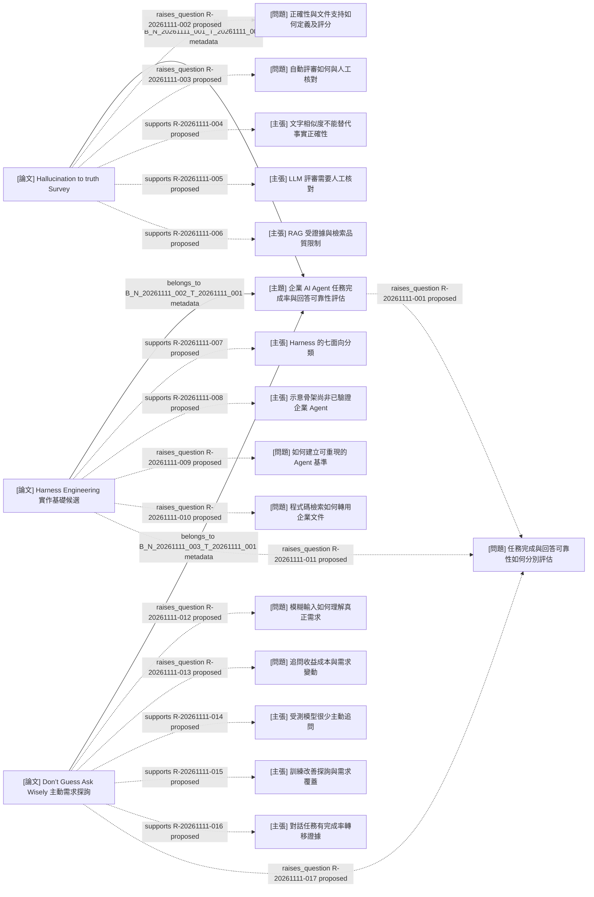

# T-20261111-001 知識圖譜

<!-- LS:GENERATED:BEGIN -->
## 生成範圍與圖例

- 研究目標：[企業 AI Agent 之任務完成率與回答可靠性評估](../topics/T-20261111-001.md)。
- 範圍：直接歸屬主題的三篇文獻、七個問題、八項主張；共十九節點、二十條邊，無子主題。
- 原生渲染狀態：**未經渲染驗證**；本檔 Mermaid 為正式圖譜來源。
- 實線為筆記 metadata 歸屬；虛線為 proposed／needs_review。本圖十七條語意關聯均為 proposed。
- 新增 MultiWOZ 對話任務完成證據；企業工具任務與真人互動仍待驗證。Survey 的引用研究未直接核讀，不建立假定已讀的文獻節點。
- Harness Engineering 是使用者預計採用的實作基礎，非教授討論文獻；其架構與示意骨架不是已驗證的企業任務完成率。
- 主動需求探詢文獻對應使用者轉述的會議問題；教授尚未被記錄為已接受此文方法。Ask%、需求覆蓋、事實正確與任務完成分開解讀。

## 圖譜

## 節點來源

| 節點 ID | 類型 | 檔案／實體連結 |
| --- | --- | --- |
| T-20261111-001 | 主題 | [唯一研究目標與彙總](../topics/T-20261111-001.md) |
| N-20261111-001 | 論文 | [原始筆記；excerpt、draft](../notes/papers/N-20261111-001.md) |
| N-20261111-002 | 論文 | [Harness；使用者實作意向；excerpt、draft](../notes/papers/N-20261111-002.md) |
| Q-20261111-001 | 問題 | [任務完成與回答可靠性](../references/entities.md#q-20261111-001) |
| Q-20261111-002 | 問題 | [定義與評分單位](../references/entities.md#q-20261111-002) |
| Q-20261111-003 | 問題 | [自動評審與人工核對](../references/entities.md#q-20261111-003) |
| C-20261111-001 | 主張 | [文字相似度限制](../references/entities.md#c-20261111-001) |
| C-20261111-002 | 主張 | [評審需人工核對](../references/entities.md#c-20261111-002) |
| C-20261111-003 | 主張 | [RAG 證據限制](../references/entities.md#c-20261111-003) |
| Q-20261111-004 | 問題 | [可重現基準](../references/entities.md#q-20261111-004) |
| Q-20261111-005 | 問題 | [檢索的領域轉用](../references/entities.md#q-20261111-005) |
| C-20261111-004 | 主張 | [執行層分類](../references/entities.md#c-20261111-004) |
| C-20261111-005 | 主張 | [示意骨架限制](../references/entities.md#c-20261111-005) |
| N-20261111-003 | 論文 | [主動需求探詢；excerpt、draft](../notes/papers/N-20261111-003.md) |
| Q-20261111-006 | 問題 | [使用者轉述的會議問題](../references/entities.md#q-20261111-006) |
| Q-20261111-007 | 問題 | [追問收益與成本](../references/entities.md#q-20261111-007) |
| C-20261111-006 | 主張 | [受測模型的追問傾向](../references/entities.md#c-20261111-006) |
| C-20261111-007 | 主張 | [訓練改善探詢](../references/entities.md#c-20261111-007) |
| C-20261111-008 | 主張 | [任務完成的轉移邊界](../references/entities.md#c-20261111-008) |

## 關聯與證據

語意關聯的正式紀錄見[台帳](../references/relations.md)。

| R ID／衍生 B 識別 | from | relation | to | 狀態 | 證據 | 條件／警示 |
| --- | --- | --- | --- | --- | --- | --- |
| B_N_20261111_001_T_20261111_001 | N-20261111-001 | belongs_to | T-20261111-001 | metadata | [筆記 topic_ids](../notes/papers/N-20261111-001.md) | 由歸屬衍生，不是語意確認 |
| R-20261111-001 | T-20261111-001 | raises_question | Q-20261111-001 | proposed | [使用者研究背景](../notes/papers/N-20261111-001.md#研究背景與教授會議共識) | Agent 問題整理；任務完成率文獻待補 |
| R-20261111-002 | N-20261111-001 | raises_question | Q-20261111-002 | proposed | [E003](../notes/papers/N-20261111-001.md#e003)、[E005](../notes/papers/N-20261111-001.md#e005)、[E008](../notes/papers/N-20261111-001.md#e008) | 尚未選定評分單位與分母 |
| R-20261111-003 | N-20261111-001 | raises_question | Q-20261111-003 | proposed | [E006](../notes/papers/N-20261111-001.md#e006)、[E007](../notes/papers/N-20261111-001.md#e007) | 尚無人工核對實驗 |
| R-20261111-004 | N-20261111-001 | supports | C-20261111-001 | proposed | [E004](../notes/papers/N-20261111-001.md#e004) | Survey 轉述；相似度仍可輔助文字比較 |
| R-20261111-005 | N-20261111-001 | supports | C-20261111-002 | proposed | [E006](../notes/papers/N-20261111-001.md#e006)、[E007](../notes/papers/N-20261111-001.md#e007) | Survey 轉述；人工判斷亦有差異 |
| R-20261111-006 | N-20261111-001 | supports | C-20261111-003 | proposed | [E011](../notes/papers/N-20261111-001.md#e011) | Survey 轉述；企業適用性待驗證 |
| B_N_20261111_002_T_20261111_001 | N-20261111-002 | belongs_to | T-20261111-001 | metadata | [新筆記 topic_ids](../notes/papers/N-20261111-002.md) | 歸入研究主題；非教授已審閱 |
| R-20261111-007 | N-20261111-002 | supports | C-20261111-004 | proposed | [E001](../notes/papers/N-20261111-002.md#e001) | 架構分類，不是可靠性量表 |
| R-20261111-008 | N-20261111-002 | supports | C-20261111-005 | proposed | [E003](../notes/papers/N-20261111-002.md#e003)、[E008](../notes/papers/N-20261111-002.md#e008) | 骨架未經企業控制實驗驗證 |
| R-20261111-009 | N-20261111-002 | raises_question | Q-20261111-004 | proposed | [E003](../notes/papers/N-20261111-002.md#e003)、[E008](../notes/papers/N-20261111-002.md#e008)、[使用者意向](../notes/papers/N-20261111-002.md#個人評析) | 基準與比較設計待確認 |
| R-20261111-010 | N-20261111-002 | raises_question | Q-20261111-005 | proposed | [Harness E005](../notes/papers/N-20261111-002.md#e005)、[E007](../notes/papers/N-20261111-002.md#e007)、[Survey E011](../notes/papers/N-20261111-001.md#e011) | 任務不同；未建 contradicts 邊 |
| R-20261111-011 | N-20261111-002 | raises_question | Q-20261111-001 | proposed | [E003](../notes/papers/N-20261111-002.md#e003)、[使用者意向](../notes/papers/N-20261111-002.md#個人評析) | 架構設計與兩項評估仍須分別處理 |
| B_N_20261111_003_T_20261111_001 | N-20261111-003 | belongs_to | T-20261111-001 | metadata | [筆記 topic_ids](../notes/papers/N-20261111-003.md) | 歸屬衍生，不是接受語意推論 |
| R-20261111-012 | N-20261111-003 | raises_question | Q-20261111-006 | proposed | [會議問題](../notes/papers/N-20261111-003.md#第一次文獻回顧會議議題)、[E001](../notes/papers/N-20261111-003.md#e001) | 使用者議題，不代表教授已接受本文 |
| R-20261111-013 | N-20261111-003 | raises_question | Q-20261111-007 | proposed | [E004](../notes/papers/N-20261111-003.md#e004)、[E007](../notes/papers/N-20261111-003.md#e007)、[E009](../notes/papers/N-20261111-003.md#e009) | Agent 延伸；真人及動態需求待測 |
| R-20261111-014 | N-20261111-003 | supports | C-20261111-006 | proposed | [E006](../notes/papers/N-20261111-003.md#e006) | 七模型與本文協定限定 |
| R-20261111-015 | N-20261111-003 | supports | C-20261111-007 | proposed | [E005](../notes/papers/N-20261111-003.md#e005)、[E006](../notes/papers/N-20261111-003.md#e006)、[E007](../notes/papers/N-20261111-003.md#e007) | 覆蓋不等於事實正確或企業完成 |
| R-20261111-016 | N-20261111-003 | supports | C-20261111-008 | proposed | [E008](../notes/papers/N-20261111-003.md#e008) | MultiWOZ 模擬對話；非企業實測 |
| R-20261111-017 | N-20261111-003 | raises_question | Q-20261111-001 | proposed | [E004](../notes/papers/N-20261111-003.md#e004)、[E008](../notes/papers/N-20261111-003.md#e008) | 區分追問、需求覆蓋與最終成功 |

## 覆蓋與省略

- 已讀來源與當時 updated：N001 及最初六筆 Q／C、R 為 2026-11-11T19:08:21+08:00；N002、Q004–Q005、C004–C005、R007–R011 為 19:30:42；主題、N003、Q006–Q007、C006–C008、R012–R017 為 19:48:47（同日 +08:00）。三篇原始筆記與十七條關聯端點、證據均已回讀。
- 閱讀限制：三篇皆 excerpt。探詢文獻依公開 PDF 正文、限制與附錄 C／J 指定段落；未完整核讀附錄、程式碼、本地版本或圖像。前兩篇既有閱讀聲明不變。
- 未讀／失效來源：追讀候選、企業任務集與真人實測尚缺；目前未發現失效端點或證據連結。
- 子圖／省略 ID 與原因：無，十九個節點及二十條邊全部涵蓋，未超過單圖上限。
- 台帳尚待核准的變更：無未寫入的改列草案；十七條候選關聯均保持 proposed。保留既有原始資料與主題人工區；既有版本回復依據為 Git `3e1e4db`。本圖未經渲染驗證。
<!-- LS:GENERATED:END -->
